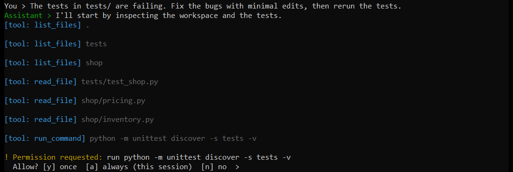
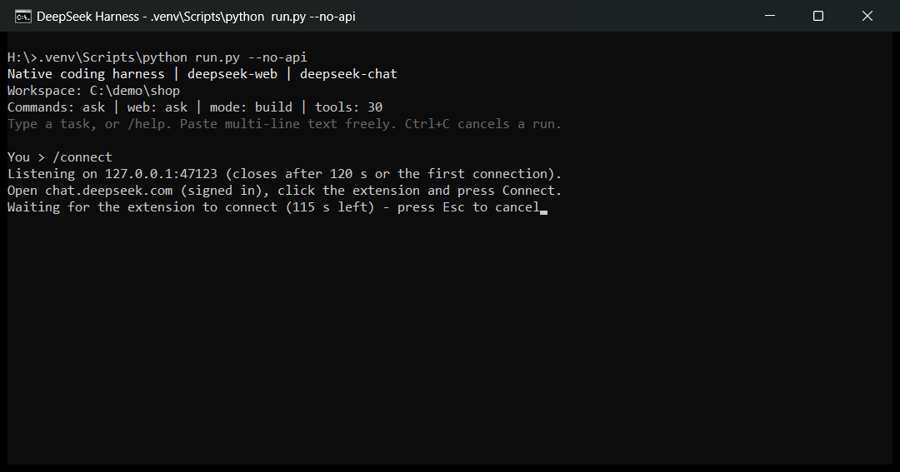
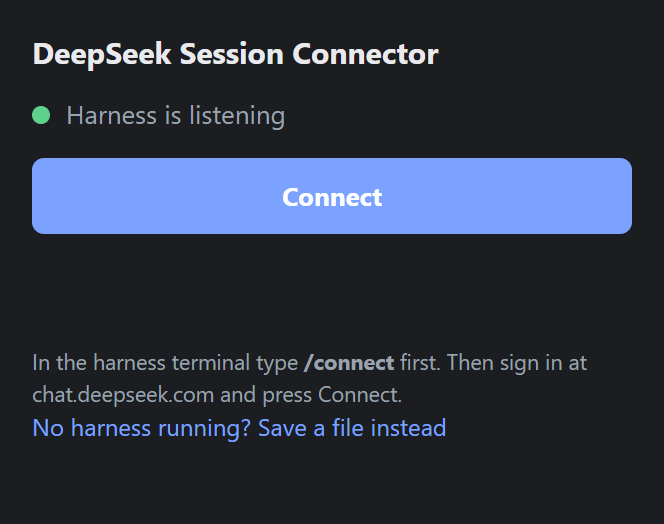
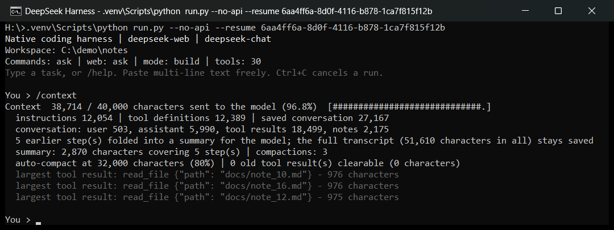

# DeepSeek Web Harness

A terminal coding agent in the style of Claude Code and Codex CLI, running on **DeepSeek's web chat**. It reads and edits your
files, runs commands, searches the web, plans, delegates to sub-agents and checks its own work. The same agent is also served as
an **OpenAI- and Anthropic-compatible local API**.

**Version 1.0.0**

> **⚠️ Educational use only.** This is a learning and research project, **unofficial and not affiliated with DeepSeek**.
> The default `deepseek-web` provider was built by **reverse engineering the chat website's private web protocol**. Those
> endpoints are not a public API, may change at any time, and using them from a program **may violate DeepSeek's Terms of
> Service. It can get your account rate-limited, muted, blocked, suspended or permanently banned**, possibly without warning
> (heavy automated testing got the author's own test account muted for days). Use an account you can afford to lose, keep usage
> light, and for anything real use the official API ([details](#account-risk-and-the-official-api)). Provided "as is", without
> warranty; you are responsible for how you use it.

<p align="center">
  
</p>

## Features

- **Real agent loop:** model turn, validated tool call, observed result, repeat. Tools for file search/read/edit (atomic, with
  `/undo` checkpoints), `apply_patch`, shell and process control, git, web search/fetch, planning, sub-agents, skills and MCP.
- **Honest verification:** records which checks actually ran and will not call edited work finished without a passing check.
- **Safe by default:** confined to one workspace folder; commands and web access ask first; plan mode is read-only.
- **Long sessions:** old tool output is cleared and older steps are folded into a model-written summary automatically
  (`/compact`, `/context`). Sessions are durable and resumable.
- **Browser-based sign-in:** `/connect` plus one click in the bundled extension; the harness never automates DeepSeek's login.
- **Scriptable:** one-shot `-p` runs, plus OpenAI Chat Completions, OpenAI Responses and Anthropic Messages endpoints.

## Quick start

Requires **Python 3.10+** and Chrome or Edge (for the sign-in extension). Developed and tested on Windows 11; Linux and macOS
are untested.

```powershell
git clone https://github.com/darkness0308/deepseek-web-harness.git
cd deepseek-web-harness
python -m venv .venv
.venv\Scripts\pip install -r requirements.txt
copy .env.example .env
```

Sign in (below), then start the agent in the folder you want it to work on:

```powershell
$env:HARNESS_WORKSPACE = "C:\path\to\your\project"   # default: this repository
.venv\Scripts\python run.py
```

Type a task, such as `The tests are failing, find out why and fix them`, or `/help` for commands.

## Sign in

DeepSeek's login rejects automated browsers, so the harness borrows the session of your normal, signed-in browser:

1. Open `chrome://extensions` (or `edge://extensions`), enable *Developer mode*, choose *Load unpacked* and select
   `extension/deepseek-session-exporter`. Do this once.
2. Sign in at <https://chat.deepseek.com> in that browser.
3. In the harness type **`/connect`** (it waits; **Esc** cancels), then click the extension's **Connect** button.

| Terminal | Extension |
|---|---|
|  |  |

`/connect` listens on `127.0.0.1:47123` only while it waits, accepts only this extension (pinned by its manifest key) from your own
machine, and closes after one connection, two minutes or three failed attempts. `/connect code` adds a pairing code. The token is
never displayed or logged. Alternatives: drop a cookie export, Playwright state or "Copy as cURL" file into `cookies/`, or run
`python import_session.py --token-prompt`. See the [extension README](extension/deepseek-session-exporter/README.md).

## Using the terminal

| Command | What it does |
|---|---|
| *(plain text)* | Give the agent a task |
| `!<command>` | Run a shell command yourself |
| `/plan`, `/build` | Read-only planning / editing mode |
| `/diff`, `/undo`, `/checks` | Review changes, restore the last checkpoint, show verification evidence |
| `/compact [focus]`, `/context` | Free context with a summary / show where the budget goes |
| `/new`, `/sessions`, `/resume <id>`, `/fork` | Manage durable sessions |
| `/permissions [ask\|auto]`, `/think [on\|off]` | Approval policy, deep thinking |
| `/connect`, `/doctor [live]` | Connect the extension, diagnose the setup |

```text
python run.py -c                          continue the most recent session
python run.py -p "task" --auto-approve    one prompt, then exit (--output-format json | stream-json)
python run.py --mode plan -p "question"   read-only
python run.py --api-only | --no-api       API without the terminal | terminal without the API
python run.py --doctor [--live]           check the environment and the provider
```

Shell commands and web access ask first (`y` once, `a` always this session, `n` no). Configure with
`HARNESS_ALLOW_COMMANDS` / `HARNESS_ALLOW_WEB` = `ask`, `true` or `false`.

## Context management

Long tasks are managed in tiers, always on a copy sent to the model; the saved transcript is never shortened:

1. **Clear old tool results:** bulky outputs from older steps become one-line stubs.
2. **Fold older steps into a summary:** the model writes a structured handoff (requests, work and evidence, files, errors, facts,
   next step); later compactions merge it with newer steps. A deterministic digest is the fallback.
3. **Automatic:** at `HARNESS_AUTOCOMPACT` percent (default 80) of `HARNESS_CONTEXT_CHARS` it runs by itself.

<p align="center">
  
</p>

In a stress run with a deliberately small 40,000-character budget, 16 notes were read one per step and all 16 facts were still
recalled correctly after five automatic compactions. The budget counts characters, not tokens, and a summary can omit details, so
keep durable facts in files or the plan.

## Safety model

- **Workspace boundary:** file tools and commands stay inside `HARNESS_WORKSPACE`; credential files, `.git` metadata and the
  session database are refused.
- **Atomic, checkpointed, line-ending-aware edits** (CRLF files stay CRLF).
- **Untrusted content stays untrusted:** file text, web pages and command output are evidence, never instructions.
- **Local API resists the browser:** on loopback it rejects non-local `Host` headers (DNS rebinding) and foreign browser
  `Origin`s, caps body size, throttles wrong API keys, and refuses a network-facing bind that has no API key. SDKs and curl are
  unaffected. See `BRIDGE_*` in [`.env.example`](.env.example).
- **Private files stay local:** `.env`, `session.json`, `api_keys.json`, `cookies/` and `.harness/` are git-ignored; credentials,
  prompts and tool arguments are not logged.
- Commands run with **your** OS permissions and are **not sandboxed**. Read what you approve.

## API

`python run.py` also serves `http://127.0.0.1:11434/v1`. Set `BRIDGE_API_KEY` (or create named keys) before binding it to a network.

| Endpoint | Purpose |
|---|---|
| `POST /v1/chat/completions` | OpenAI Chat Completions (streaming, tool calling) |
| `POST /v1/responses` | OpenAI Responses (Codex-style clients) |
| `POST /v1/messages` | Anthropic Messages (Claude Code-style clients) |
| `POST /v1/agent/runs` | Run the native agent with its own tools |
| `/v1/sessions…` | Durable sessions: `fork`, `export`, `compact`, `context`, `undo`, `review` |
| `GET /v1/models`, `/v1/tools`, `/v1/skills`, `/v1/health` | Discovery and health |

```powershell
curl http://127.0.0.1:11434/v1/chat/completions -H "Content-Type: application/json" `
  -d '{"model":"deepseek-chat","messages":[{"role":"user","content":"Say hi"}]}'
```

Contracts: [docs/harness.md](docs/harness.md), [docs/advanced-harness.md](docs/advanced-harness.md), [docs/api.md](docs/api.md).

## Configuration

Copy `.env.example` to `.env`; every setting is documented there. The main ones:

| Setting | Default | Meaning |
|---|---|---|
| `HARNESS_WORKSPACE` | this repository | Folder the agent may read and edit |
| `HARNESS_ALLOW_COMMANDS` / `HARNESS_ALLOW_WEB` | `ask` | Approval policy |
| `HARNESS_MAX_TURNS` / `HARNESS_TIMEOUT` | `40` / `600` | Model turns and seconds per run |
| `HARNESS_CONTEXT_CHARS` / `HARNESS_AUTOCOMPACT` | `120000` / `80` | Context budget / auto-compact percent (`0` = off) |
| `HARNESS_PROVIDER` / `HARNESS_MODEL` | `deepseek-web` / `deepseek-chat` | Provider (`openai` for any OpenAI-compatible API) |
| `BRIDGE_HOST` / `BRIDGE_PORT` / `BRIDGE_API_KEY` | `127.0.0.1` / `11434` / empty | Local API bind address and key |

## Troubleshooting

| Symptom | Fix |
|---|---|
| `authentication token was rejected` | Sign in again at chat.deepseek.com, then `/connect` and click Connect |
| `DeepSeek has muted this account's chat until ...` | DeepSeek restricted the account; wait for the date shown ([risk](#account-risk-and-the-official-api)) |
| `rate_limit_reached` | DeepSeek is throttling; wait a few minutes, then say `continue` |
| `Session database is in use by another harness process` | Close the other `run.py`, or set a different `HARNESS_STATE_PATH` |
| `/connect` says the port is unavailable | Another `/connect` is open, or port 47123 is used (`HARNESS_CONNECT_PORT`) |
| Extension says *Harness is not listening* | Type `/connect` in the harness first |

`python run.py --doctor --live` checks the whole chain; `logs/harness.log` has details (never credentials or prompts).

## Account risk and the official API

Automated use of DeepSeek's website is the traffic its anti-abuse systems look for. Outcomes range from rate limiting and a
revoked token to a temporary mute and a **block, suspension or permanent ban**. The harness reports what DeepSeek says and never
retries a mute, but it cannot lift one. To reduce the risk: use a throwaway account, run one task at a time, avoid unattended
loops and test batteries, and stop when you see a mute or authentication error.

The agent, tools, context management and API do not depend on the website route. For real work, point them at DeepSeek's
**official API** (or any OpenAI-compatible service) with a key from your own platform account:

```env
HARNESS_PROVIDER=openai
HARNESS_BASE_URL=https://api.deepseek.com/v1
HARNESS_API_KEY=<your official API key>
HARNESS_MODEL=deepseek-chat
```

The OpenAI-compatible provider is covered by automated tests during development but was not exercised live against DeepSeek's API.

**Further reading** (all in `docs/`)

| Guide | Covers |
|---|---|
| [Native harness guide](docs/harness.md) | Commands, every setting, permissions, API contracts, local API protections, failure handling |
| [Advanced runtime](docs/advanced-harness.md) | Durable sessions, context and compaction, tools, plans, verification, skills, MCP |
| [Web-route API reference](docs/api.md) | Session, share, export and TTS endpoints of the DeepSeek web bridge |
| [Legacy chat commands](docs/commands.md) | Reference for `python run.py --legacy-chat` (the original web chat UI) |
| [Archived original README](docs/legacy-web-bridge.md) | The previous README: legacy bridge details and pre-1.0 history |

## Legal

"Educational use" states the intent of this repository; it does not by itself make any use permitted. Read the terms of any
service you connect to and follow the laws that apply to you. Do not use this to circumvent limits, share or resell access, or
scrape at scale. No credentials are collected or sent anywhere except to DeepSeek as part of your own requests. Bundled
third-party skills keep their original licenses (see `skills/`). The project's own code is released under the
[MIT License](LICENSE); that license covers this software only and grants no rights to DeepSeek's service or its terms.
